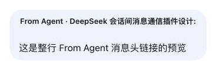

# dsh-agent-message

[English](./README.en.md) | 中文

> DeepSeek Harness 的**跨会话 Agent 通信**插件：让运行在同一个进程里的不同 Agent 会话，像发消息一样互相收发信息。


---

## 这是什么

在 DeepSeek Harness 里，一个进程会同时挂着多个 Agent 会话。本插件给每个会话装上三个工具，让它们能互相"发消息"：

- 发消息前，先**列出所有可发送的独立会话**（未归档、排除真实子代理，含离线未打开的），按标题找到目标；
- 找到后，**把消息投递到目标会话**——普通消息统一进入独立的新 turn；目标离线（进程重启后还没打开）时，插件通过 Harness 公开接口恢复会话、投递，并保持加载供后续通信，插件卸载时再释放 handle；
- 需要时，可以**按需查询**某条消息的送达状态（排队中/已认领/被丢弃/未知），并单独查看目标是否正在运行，供监督场景使用。

典型场景：编排者 Agent 给开发 Agent 派活、两个 Agent 协作接力、主会话给测试会话发指令、监督者 Agent 盯梢多个 worker。

## 功能

| 能力 | 说明 |
|---|---|
| `list_peer_agents` | 列出所有**可发送**的独立会话：未归档、排除真实子代理；普通 fork 保留。返回 id、标题、工作目录和运行状态 |
| `send_agent_message` | 给指定会话 ID 发消息；默认使用 `followup` 创建独立的新 turn，离线时自动恢复后投递；显式支持 `followup`、`inject`、`steer` |
| `check_delivery` | 按需查询消息回执（pending/claimed/discarded/unknown）；发送成功时先返回 accepted，接纳前失败由工具错误表示；指定消息 ID 时支持重启后恢复查询 |
| Harness 原生 `@` 会话引用 | 直接复用 Harness 的结构化 Session Reference；选择后当前 Agent 获得稳定 Session ID 和一份有界、只读、标记为不可信的会话快照。引用本身不会发送消息或唤醒目标 |
| 可见的 Agent 消息卡片 | relay 仍保留真实的插件来源，但 Client 将它显示为左侧 Agent 消息卡片；`From Session · <名称>:` 可点击或通过键盘打开发送方会话，文案跟随 Harness 语言设置 |
| 复制会话 ID | 会话头部新增「复制ID」按钮，一键复制当前会话 ID |
| 投递卡片设置 | 在设置 → 插件配置中，可切换是否显示投递模式和目标运行状态；`messageId` 始终显示 |

### 发送方导航示例



当前 relay 消息显示为可见的 Agent 消息卡片；点击消息头即可跳转到发送方会话。持久化来源仍是插件 `relay`，不会伪装成人类输入。完整会话 ID 同时保留在 typed source 和 Host 生成的模型可见协议头中，避免接收 Agent 猜测发送方。

### 投递模式（`send_agent_message` 的 `mode` 参数）

| mode | 含义 |
|---|---|
| （默认，不传） | `followup`：给目标创建独立的新 turn；离线时自动 `resume` 后投递 |
| `followup` | 与默认相同；在线直接排队，离线自动恢复后排队 |
| `steer` | 立即介入对方当前工作（仅 `running` 会话） |
| `inject` | 不打断当前目标，静默补充下一步上下文（仅 `running` 会话） |

**归档会话和真实子代理一律拒绝发送**；普通 fork 仍是独立会话，可以发送。发给自己也会被拒绝。

## 安装

### 方式一：一行命令（推荐）

```sh
dsh plugin --profile web add dsh-agent-message
```

装完即自动注册，无需任何额外配置。

兼容范围：Node.js 24、DeepSeek Harness `>=0.1.1-rc.2 <0.2.0`。会话日志读取与回执归属路径已分别按旧合同 `0.1.1-rc.2` 与当前合同 `0.1.5-rc.1`（随附 `dsh-session-query` `0.1.5-rc.2`）核对；Node.js 验证版本为 `24.x`。

### 方式二：从 GitHub 安装

```sh
dsh plugin --profile web add github:GengDaPeng/dsh-agent-message
```

### 方式三：直接发给你的 Agent

打开任意一个 DSH 会话，把下面这句话发给它：

> 帮我安装跨会话通信插件，执行：`dsh plugin --profile web add dsh-agent-message`

Agent 会用 bash 执行这条命令，装完自动挂载、所有会话立即可用。

### 装完自动发生了什么

插件自带 `cordis.patch.yml`（由 `package.json` 的 `dsh.bundle.patch` 指向），安装后自动把自己挂进宿主组合——所以你**不需要**手动改 preset、改 `cordis.patch.yml`。所有会话自动获得 `list_peer_agents`、`send_agent_message` 和 `check_delivery`。

## 使用

1. 在会话 A 的输入框中键入 `@`，从 Harness 原生候选菜单中选择目标会话；
2. Harness 会把该 Session 的有界、只读、不可信快照提供给 A，但不会向 B 发消息或唤醒 B。只有当前请求或用户已授予的编排职责明确要求跨会话传递信息时，A 才调用 `send_agent_message`。例如 `@B 告诉他最后提交 PR draft 就停止` 会发送；`@B 帮我分析他最新的对话结果` 只使用引用快照；
3. 显式要求转告时，A 只负责投递并报告“已接受”或失败，不代为执行被转发的任务，也不要求 B 额外回复“收到”；如果正文明确要求 B 把业务内容返回 A，B 才向 `senderSessionId` 发送消息；
4. 也可以让 Agent 调 `list_peer_agents`，再用完整会话 ID 直接发送；
5. 会话 B 收到的是带 typed relay source 的原生 `UserMessage`；正文首行还有 Host 生成的最小来源协议，B 不需要猜测发送方；Client 将其显示为可见 Agent 消息卡片，并可从消息头打开发送方会话；
6. （监督场景）说「查一下我发给 `<会话ID>` 的消息状态」——它会调 `check_delivery`。

## 原理

每个 Agent 都有一个收件箱 `Inbox`，里面是两条 FIFO 队列：

- `next-turn`：排队等待作为**独立一轮**处理的消息；
- `next-step`：当前轮次内、**下一步边界**消费的引导输入。

`send_agent_message` 的投递路径：

- **在线普通消息**：通过 `agents` 注册表找到目标 Agent，调用 `followup()` 进入独立的 `next-turn`；
- **运行中高级语义**：用户无需说出模式名；Agent 根据整句话判断，明确要求立即介入时使用 `steer()`，明确要求不打断当前任务、只补充上下文时使用 `inject()`；目标必须确实为 `running`，判断不清时仍使用默认 `followup()`；
- **离线普通消息**：先由 `sessionQuery.observeSession()` 读取同一份逻辑会话快照并校验目标，再通过公开 `agents.resume()` 恢复、调用 `followup()`；插件持有并复用恢复得到的 handle，目标回到 idle 后仍保持加载，只在插件卸载时释放。恢复失败直接返回失败，不伪造核心 Inbox 事件作为留言。

会话枚举、批量标题和离线日志读取分别使用 Harness 的 `sessionQuery.listSessions()`、`readTitleSnapshots()` 与 `observeSession()`。`SessionId` 是唯一地址；`parentSession` 只记录分叉血缘，只有 `origin: subagent` 才会被识别为真实子代理。插件不直接扫描 `sessionPersistence` 重建另一份会话目录。选择 `observeSession()` 是因为它同时给出会话头、精确继承边界与事件，且能读取分叉会话；旧的 `readSession()` 在当前宿主上对分叉会话会直接抛错（种子必须等于继承前缀），仅作为宿主未提供前者时的回退。

`send_agent_message` 成功把原生消息提交给目标 Inbox 后立即返回 `accepted` 和该消息的原生 `messageId`；精简工具结果和完整工具卡片都会显示可选择复制的 `messageId`，完整结果同时保留在工具呈现元数据中。`check_delivery` 根据 Inbox 事件按需返回 `pending`（仍在排队）、`claimed`（已被某轮认领）、`discarded`（被取消）或 `unknown`。`claimed` 只是传输证据，不表示已读、回复或任务完成。接纳前失败由 Harness 工具错误表示，不写入目标 Inbox。目标是否正在运行通过独立的 `targetRuntimeStatus` 返回，不把 Agent 的整体运行状态误当成某条消息正在处理。指定 `messageId` 时可从目标现有 Inbox 日志恢复状态，因此进程重启后仍可查询。

回执归属只统计目标会话**自有**的 Inbox 事件，在线与离线使用同一条规则。分叉会话继承的父会话历史属于父会话：父会话收到的消息被认领或丢弃，不会出现在分叉的回执里；向分叉新发送的消息仍可正常查询。边界取自宿主公开的继承信息（在线为 `Session.ownEvents()`，离线为 `SessionLogSnapshot.inheritedEventCount`，旧版合同为 `header.seedLength`）。宿主既声明存在分叉、又无法给出可判定边界时，查询返回明确的受控错误，不静默按「没有继承历史」折叠，也不伪装成 `unknown`。

所有跨会话消息都由 Harness `createUserMessage()` 创建，`UserMessage.id` 是唯一消息身份。`source.kind` 固定为 `dsh-agent-message`，`form` 固定为 `relay`，并携带协议版本、发送/目标 Session 和显示标题。由于当前 Harness 不会把自定义 source 字段展开给模型，Host 还会在正文首行写入只含 `senderSessionId` 的最小 `<dsh-agent-message>` 协议头；source 是持久化/UI 真相，协议头只是回复寻址所需的模型可见投影。插件不注册全局系统提示词，发送准入只存在于 `send_agent_message` 的工具合同中。Client 只把 relay 投影为可见的 Agent 消息卡片，不会反向把 Agent 消息伪装成人类 `user` 来源。

relay 只表达“另一会话发来的消息”，本身不等于必须回复或禁止回复。正文明确要求返回业务内容时，接收 Agent 可用同一工具向 `senderSessionId` 发送消息；没有明确要求时不回传 transport ack 或单纯的“收到”。插件不自动关联请求与回复，也不自动转发 Agent 的普通回答。

输入框的 `@` 完全由 Harness 原生 `ui-reference` / `session-reference` 提供，结构化引用保留稳定 Session ID，并由 Harness 负责读取和注入有界快照。插件不再注册自己的 `@` source、不解析标题寻址，也不维护第二套会话引用 UI。

完整的现役架构合同见 [`docs/architecture-v2.md`](./docs/architecture-v2.md)。

## 目录结构

```
dsh-agent-message/
├── lib/
│   ├── index.js        # host 半区：list_peer_agents / send_agent_message / check_delivery
│   └── client.js       # client 半区：relay 显示、发送方导航、设置与复制会话ID按钮
├── cordis.patch.yml    # 自注册补丁（dsh.bundle.patch 指向它）
├── package.json        # DSH 插件清单（dsh.bundle / dsh.client / dshx.contributes）
├── docs/               # 现役/候选架构与 README 示例截图
├── scripts/web-smoke.mjs # 真实 Web Profile 启动与配置冒烟
├── README.md           # 中文文档
└── README.en.md        # English documentation
```

## 开发验证

```sh
pnpm test
pnpm run test:web-smoke
pnpm peers check
```

`test:web-smoke` 需要本机已安装 `dsh` 并配置 Web Profile，它只验证启动、插件组合和 HTTP 可达性；真实交互验收记录见 [`docs/architecture-v2.md`](./docs/architecture-v2.md#14-验证记录)。

## 限制

- 目标会话必须**未归档**且存在于本机持久化里；归档会话一律拒绝发送。
- 工具只用于独立 Session 之间通信；真实子代理既不会出现在目标列表中，也不能作为调用方使用这些工具。
- 同一对 Session（不分发送方向）在滚动 60 秒内最多投递 10 条消息；第 11 条会在写入目标 Inbox 前被拒绝。该窗口只属于当前 Harness 进程，重启后清空。
- 自动恢复离线会话时会使用**默认模型**（不继承它上次手动切换的模型选择）；恢复失败时消息不会被写入目标 Inbox。
- 不指定 `messageId` 的批量回执依赖内存记账，只覆盖本进程最近 1000 条发送记录（FIFO 淘汰）；进程重启后仍可凭已知 `messageId` 查询，但不再返回易失的 `sentAt` 和 `mode`。
- 跨进程/跨机器通信不在本插件范围内。

## License

[MIT](./LICENSE)
